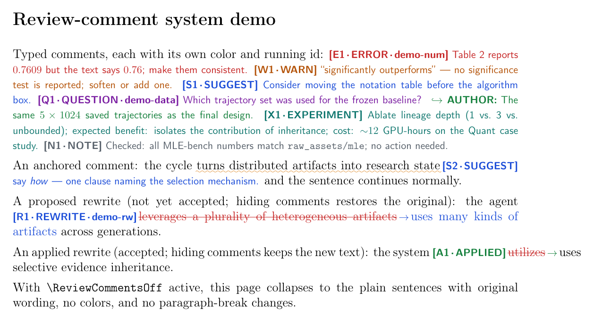
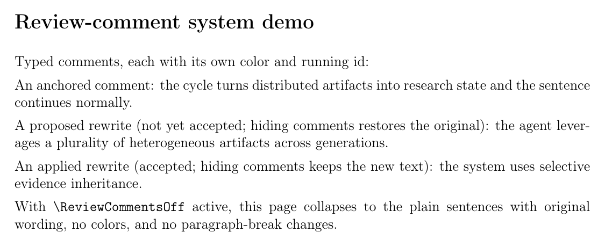

# Review-comment system

Inline, colored review annotations for a LaTeX paper, designed for an
agent-annotates → author-answers → agent-applies workflow. This repo is meant
to be included in a paper repo as a git submodule (conventionally at
`review/`):

- `comments.tex` — the implementation (loaded from the paper's `main.tex`).
- `review_fallback.tex` — canonical copy of the host-side fallback; **copy it
  into the host repo root** (see Quick start — it cannot be loaded from the
  submodule, because it is needed exactly when the submodule is absent).
- `README.md` — this manual.
- `MEMORY.md` — agent instructions for the git-ignored `memory/` folder that
  records the author's review preferences across sessions.
- `demo.tex` — one example of every command; temporarily `\input{review/demo}`
  in `main.tex` to preview the rendering.
- `demo_standalone.tex` — minimal driver that compiles `demo.tex` without a
  host paper; used to regenerate the screenshots below.
- `assets/` — the rendered screenshots embedded below.

## What it looks like

`demo.tex` compiled with comments visible — every command in action:



The **same source** after adding the single `\ReviewCommentsOff` toggle —
typed comments vanish, the anchored span prints untouched, the unaccepted
`\csub` proposal falls back to the original wording, and the accepted
`\capplied` rewrite keeps the new wording:



To regenerate the screenshots (needs `pdfcrop` from TeX Live and `pdftoppm`
from poppler):

```bash
pdflatex demo_standalone
pdflatex -jobname=demo_hidden "\def\HideReviewComments{1}\input{demo_standalone}"
pdfcrop --margins 12 demo_standalone.pdf vis.pdf && pdftoppm -png -r 160 -singlefile vis.pdf assets/demo-visible
pdfcrop --margins 12 demo_hidden.pdf hid.pdf && pdftoppm -png -r 160 -singlefile hid.pdf assets/demo-hidden
rm -f vis.pdf hid.pdf
```

## Quick start

In the host paper's `main.tex` preamble:

```latex
\IfFileExists{review/comments.tex}{\input{review/comments}}{\input{review_fallback}}
% \ReviewCommentsOff
```

where the host repo's root `review_fallback.tex` is a copy of this repo's
`review_fallback.tex` (no-op versions of every command, reproducing
`\ReviewCommentsOff` semantics). The guard matters because submodule contents
are absent in plain clones and on Overleaf, whose git bridge does not fetch
submodules — with the fallback, such checkouts still build the clean paper.
Keep the host copy in sync with the canonical one whenever `comments.tex`
gains a command. After cloning the host repo, populate this folder with
`git submodule update --init`. Requires `xcolor`, `ulem` (`[normalem]`), and
`etoolbox` in the host preamble.

**Seeing comments on Overleaf.** Because the git bridge does not fetch
submodules, an Overleaf project built from a submodule setup always takes the
fallback branch, so comments never show there. If co-authors read and answer
comments on Overleaf, copy `comments.tex` into the host repo as a plain file
(e.g. `review/comments.tex`, not a submodule) and keep it in sync with this
repo by hand.

- **Hide every comment** (render the clean paper): uncomment `\ReviewCommentsOff`.
  That single command removes all review markup visually — typed comments
  vanish, `\chl` spans print untouched, `\csub` proposals fall back to the
  *original* text, `\capplied` rewrites keep the *new* text.
- **Show comments again**: re-comment the line (or call `\ReviewCommentsOn`).

## Comment types and when to use each

Every type takes an optional `[slug]` — a short stable id (e.g.
`[rocket-mass]`). Numbers (`E1`, `Q3`, …) are assigned automatically in
document order and **shift when earlier comments are removed**, so use slugs
when a comment will be discussed across sessions.

| Command | Renders as | Color | Meaning — use it for | Resolution |
|---|---|---|---|---|
| `\cerror[slug]{...}` | `[E1 · ERROR]` | red | Something objectively wrong: numbers inconsistent with tables, broken/wrong cross-references, incorrect math, claims contradicted elsewhere in the paper. | Must be fixed. If the fix touches results or claims, wait for author confirmation. |
| `\cwarn[slug]{...}` | `[W1 · WARN]` | orange | Risky but not provably wrong: overclaiming, ambiguity, internal inconsistency of terminology, a statement a referee will likely attack. | Fix or consciously accept; author decides. |
| `\csugg[slug]{...}` | `[S1 · SUGGEST]` | blue | Optional improvement: wording, structure, flow, presentation. The paper is not wrong without it. | Apply if author agrees or doesn't object; safe to drop. |
| `\cquest[slug]{...}` | `[Q1 · QUESTION]` | purple | Information only the authors have: missing data, unconfirmed details, intent. Blocks progress until answered. | Stays until the author answers with `\cans`. |
| `\cexp[slug]{...}` | `[X1 · EXPERIMENT]` | teal | A proposed *additional experiment or analysis*. Must state: what to run, expected benefit to the paper, and rough cost. High bar — only when clearly beneficial. | Author decides; convert to a plan or delete. |
| `\cnote[slug]{...}` | `[N1 · NOTE]` | gray | Neutral context: rationale for a change, cross-reference for other reviewers, "checked, this is fine". No action needed. | Delete when no longer useful. |

### Text-anchored markup

| Command | Behavior when visible | When hidden |
|---|---|---|
| `\chl{span}{comment}` | Wavy amber underline under the exact span, comment printed right after. Compose with a typed comment: `\chl{this sentence}{\csugg{passive voice; make active}}`. | Span prints untouched. |
| `\csub[slug]{old}{new}` | `[R1 · REWRITE]`, *old* struck out in red, → *new* in blue. A **proposal**, not yet accepted. | **Original** text (`old`). |
| `\capplied[slug]{old}{new}` | `[A1 · APPLIED]`, *old* struck out, → *new* in normal black ink. Change **is applied**; markup is the audit trail. | **New** text (`new`). |

## Answering a comment (author workflow)

Open the `.tex` file at the comment and add `\cans{...}` **inside the closing
brace** of the comment. The answer renders in green with an `↪ AUTHOR:` arrow,
visually distinct inside the comment:

```latex
% before
\cquest[rocket-data]{Which trajectory set was used for the frozen baseline?}
% after — just append your reply before the closing brace
\cquest[rocket-data]{Which trajectory set was used for the frozen baseline?
  \cans{The same $5\times1024$ saved trajectories as the final design; cite
  Sec.~3.4.}}
```

That's the whole protocol: the author only ever appends `\cans{...}` inside an
existing comment. Multiple `\cans` in one comment are fine (a dialogue).
Because answers live inside the comment's braces, `\ReviewCommentsOff` hides
them together with the comment.

## Lifecycle

1. **Open** — an agent inserts a typed comment (optionally anchored with
   `\chl` or paired with a `\csub` proposal).
2. **Answered** — the author appends `\cans{...}`.
3. **Applied / declined** — an agent acts on the answer:
   - accepted `\csub{old}{new}` → replace the whole macro with `new`
     (or with `\capplied{old}{new}` if the author wants a visible audit trail);
   - declined → replace the macro with `old` and delete the comment;
   - fixed `\cerror`/`\cwarn` → make the fix, delete the comment (optionally
     leave a `\cnote` explaining what changed).
4. **Removed** — before submission, no review markup remains:
   `grep -rn '\\c\(error\|warn\|sugg\|quest\|exp\|note\|ans\|hl\|sub\|applied\)' sections/`
   must return nothing, and the paper must compile identically with and
   without `\ReviewCommentsOff`.

## Reviewer memory (agents)

Agents reviewing the paper or resolving comments must keep a persistent,
**git-ignored** preference memory in `review/memory/`: read it before
touching any comment, and record new durable author preferences (accept/
decline patterns, style rulings, workflow tastes) as they surface — so the
author never has to state the same preference twice. Full protocol in
[MEMORY.md](MEMORY.md). The folder is ignored by this repo's `.gitignore`;
never commit it.

## Placement rules (agents: follow these exactly)

- Place a comment **immediately after the sentence or paragraph it concerns**,
  on its own source line, **without inserting blank lines** — a blank line
  around a mid-paragraph comment creates a paragraph break that survives
  `\ReviewCommentsOff` and corrupts the clean render.
- Never put review commands inside `\section{...}` titles, `\caption{...}`,
  footnotes, or math. Comment on a caption/title from the body text right
  after it (use the slug to say what it refers to).
- For `\csub`/`\capplied`, `old` must be the verbatim original text —
  hidden mode must reproduce the paper exactly.
- Comment bodies are normal LaTeX: escape `%`, `&`, `_` as usual; `\par` /
  multi-paragraph bodies are allowed.
- One issue per comment. Reference other comments by slug, not number.
- These comments are for the *review workflow*. The pre-existing `\TODO{...}`
  marker stays reserved for author-side missing content — don't convert TODOs
  into review comments or vice versa.

## License

MIT — see [LICENSE](LICENSE).
